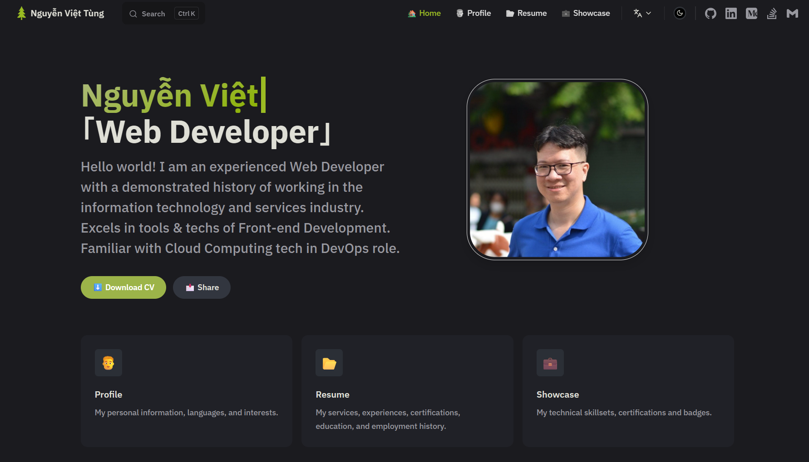

# 🚀 CV Static Website



**Personal CV and portfolio website built with [VitePress](https://vitepress.dev/)** - A modern, fast, and SEO-friendly static site for showcasing professional experience.

## ✨ Features

- **Comprehensive Profile**: Responsive photo hero with CV/email actions and labeled social links, capability and service cards, personal bio, languages, and interests
- **Experience Timeline**: Compact Experiences and Certifications cards with dates, duration, Current/Expired tags, per-entry Details, and Expand all
- **Technical Showcase**: Skills matrix, projects portfolio, and professional highlights
- **Skillset Browser**: Labeled category buttons with tool counts, contrasting logo backplates, responsive linked skill cards, and localized wishlist badges
- **Project Carousel**: Stacked GitHub repository panel, uncropped 16:9 screenshots, keyboard-accessible navigation and paging, and reduced-motion support
- **Portfolio Grid**: Uniform logo frames, always-visible company and country, and independently expanding details for products, clients, and employers
- **Bilingual Support**: English and Vietnamese content
- **SEO Optimization**: Static assets for search engines (sitemap, robots.txt)
- **PWA Ready**: Progressive Web App metadata and manifest
- **Custom Components**: Vue-powered theme with Timeline, Grid, Accordion, and Certification cards

## 🛠️ Tech Stack

| Technology | Version | Purpose |
|------------|---------|---------|
| VitePress | 1.6+ | Static site generator |
| Vue.js | 3.x | Component framework |
| Sass | Latest | Styling preprocessor |
| TypeScript | 5.x | Type safety |
| @iconify/utils | Latest | Icon processing |

## 📋 Requirements

- Node.js 18+
- npm (or Bun)

## 🚀 Quick Start

### Installation

```bash
npm install
```

**Optional**: Use Bun instead
```bash
bun install
```

### Development

Start the local development server on port 4173:
```bash
npm run docs:dev
```

### Build & Preview

Build static site for production:
```bash
npm run docs:build
```

Preview the production build locally (port 8080):
```bash
npm run docs:preview
```

Build with custom base path:
```bash
npm run docs:build -- --base "/"
```

## 📚 Content Architecture

### English Pages

| File | Description |
|------|-------------|
| [`docs/index.md`](docs/index.md) | Landing page with hero section |
| [`docs/profile.md`](docs/profile.md) | Personal profile and services |
| [`docs/resume.md`](docs/resume.md) | Experience timeline & certifications |
| [`docs/showcase.md`](docs/showcase.md) | Skills, projects, and highlights |

### Vietnamese Pages

| File | Description |
|------|-------------|
| [`docs/vi/index.md`](docs/vi/index.md) | Vietnamese landing page |
| [`docs/vi/profile.md`](docs/vi/profile.md) | Vietnamese profile section |
| [`docs/vi/resume.md`](docs/vi/resume.md) | Vietnamese resume |
| [`docs/vi/showcase.md`](docs/vi/showcase.md) | Vietnamese showcase |

## ⚙️ Configuration

### Site Settings
- **Config**: [`docs/.vitepress/config.mts`](docs/.vitepress/config.mts)
  - Site metadata, navigation structure
  - Locale settings and search configuration
  - Footer and theme options

### Theme Components
- **Layout**: [`docs/.vitepress/theme/Layout.vue`](docs/.vitepress/theme/Layout.vue) - Main layout wrapper
- **Timeline**: [`docs/.vitepress/theme/Timeline.vue`](docs/.vitepress/theme/Timeline.vue) - Experiences (`kind="experience"`) and Certifications (`kind="certification"`) timeline shared by both Resume locales; logo, title, organization, dates, and tags stay visible, each Details button expands one entry, Expand all toggles the section, and print shows every entry
- **Grid**: [`docs/.vitepress/theme/Grid.vue`](docs/.vitepress/theme/Grid.vue) - Portfolio tiles (Products, Clients, Employers) shared by both Resume locales; logo, title, and company with flag stay visible, and each tile's Details button expands only that tile
- **Accordion**: [`docs/.vitepress/theme/Accordion.vue`](docs/.vitepress/theme/Accordion.vue) - Category-first skillset browser shared by both Showcase locales; keyboard activation preserves focus, subgroup separators retain tool order, and details expand without nested scrolling
- **Certification**: [`docs/.vitepress/theme/Cert.vue`](docs/.vitepress/theme/Cert.vue) - Certification card display
- **Projects**: [`docs/components/ProjectsContainer.vue`](docs/components/ProjectsContainer.vue) - Responsive project carousel shared by both Showcase locales
- **Profile**: [`docs/components/ProfileContent.vue`](docs/components/ProfileContent.vue) - Typed, localized content sections shared by both Profile pages, with preserved section anchors and responsive cards; [`ProfileContainer.vue`](docs/components/ProfileContainer.vue) renders the identity hero, CV/email actions, and labeled social links

Profile content is defined as `ProfileContentData` in each localized Profile page. Keep translated text, captions, decorative `icon` fields for capability cards/Bio facts, and the existing section/service IDs together in this data. Section headings are unnumbered. The hero resembles a business card with a theme-aware photo beneath the entire card. The front uses one continuous 50%-opacity gray overlay to avoid seams between panels; backdrop filtering preserves readability, with a light overlay as a fallback when unsupported. A small flip button reveals the unfiltered photo, cropped to cover the reverse face edge to edge, with a localized Landmark 81/location/photographer/date note over a theme-aware translucent gray strip. A second click returns to the profile. Save photo appears only on the photo face and uses a native download link to the original JPG, without cropping, overlays, captions, or controls. The inactive face is inert and hidden from assistive technology; reduced motion disables animation, and print always shows the profile face. The portrait, typographic roles, CV action, and social brand-icon tiles retain distinct treatments. On mobile the portrait moves above the identity and social links form two columns. Hover adds photo brightness and shadow without resizing controls. Social buttons reuse the theme's brand icons. Profile styles are scoped; the hero and cards support keyboard focus, forced colors, reduced motion, and printing. CV links retain their new-tab behavior and identify the file as a PDF.

Skillset icon colors use `#RGB` or `#RRGGBB`. Inline brand logos receive an automatically contrasted neutral backplate; multicolor image assets retain a light backplate in either theme.

Portfolio Grid items use `{ img, title, url, org, orgNote?, country, countryName, desc }`. `country` is a lowercase [flagcdn](https://flagcdn.com) code, `countryName` is localized per page, and `desc` holds only the description. When the title already starts with `org`, the tile shows the country name instead of repeating the company.

Timeline experiences use `{ start, end?, title, org, orgUrl, logo, roles: [{ name, html }] }` and certifications use `{ title, url?, issuer, issuerUrl, logo, issued, start?, expires?, desc }`. Dates are `YYYY-MM` and are formatted per locale (`Jan 2026` / `01 / 2026`). Omit `end` for the current role; its duration and any Expired tag (`expires` before the current month) are computed in the browser after hydration.

## 📁 Static Assets

| Directory/File | Purpose |
|----------------|---------|
| `docs/public/content/` | Downloadable CV and professional documents |
| `docs/public/images/` | Brand icons, cloud provider logos |
| [`manifest.json`](docs/public/manifest.json) | PWA metadata for installability |
| [`robots.txt`](docs/public/robots.txt) | Search engine crawler directives |
| [`sitemap.xml`](docs/public/sitemap.xml) | SEO sitemap for better indexing |

## 🗂️ Project Structure

```
cv-static-website/
├── docs/
│   ├── .vitepress/
│   │   ├── config.mts
│   │   └── theme/
│   │       ├── index.ts
│   │       ├── Layout.vue
│   │       ├── Timeline.vue
│   │       ├── Grid.vue
│   │       ├── Accordion.vue
│   │       └── Cert.vue
│   ├── components/
│   ├── public/
│   │   ├── content/
│   │   ├── images/
│   │   ├── manifest.json
│   │   ├── robots.txt
│   │   └── sitemap.xml
│   ├── vi/          # Vietnamese pages
│   ├── index.md     # Homepage
│   ├── profile.md   # Profile section
│   ├── resume.md    # Resume
│   └── showcase.md  # Portfolio
├── package.json
└── tsconfig.json
```

## 📜 License

This project is licensed under the **[MIT License](LICENSE)** - see the file for details.

## 🤝 Contributing

Contributions are welcome! Please follow these steps:

1. Fork the repository
2. Create your feature branch (`git checkout -b feature/amazing`)
3. Commit your changes (`git commit -m 'Add some amazing feature'`)
4. Push to the branch (`git push origin feature/amazing`)
5. Open a Pull Request

## 📞 Support

For questions or issues, please open an issue on GitHub.

---

**Built with ❤️ using VitePress**